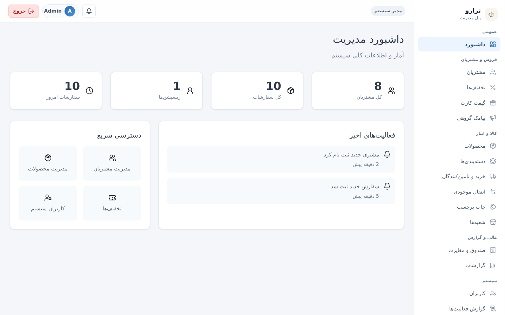
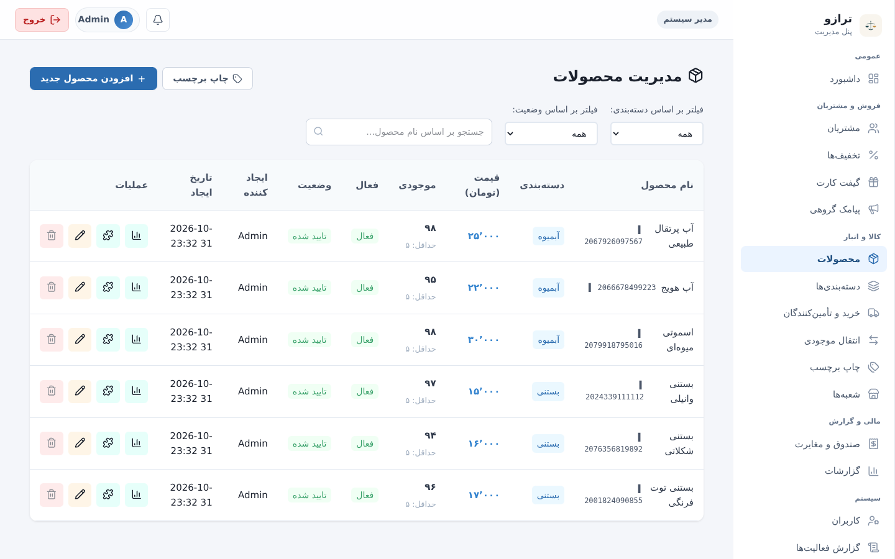
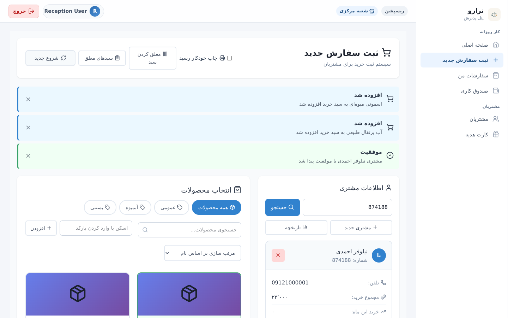
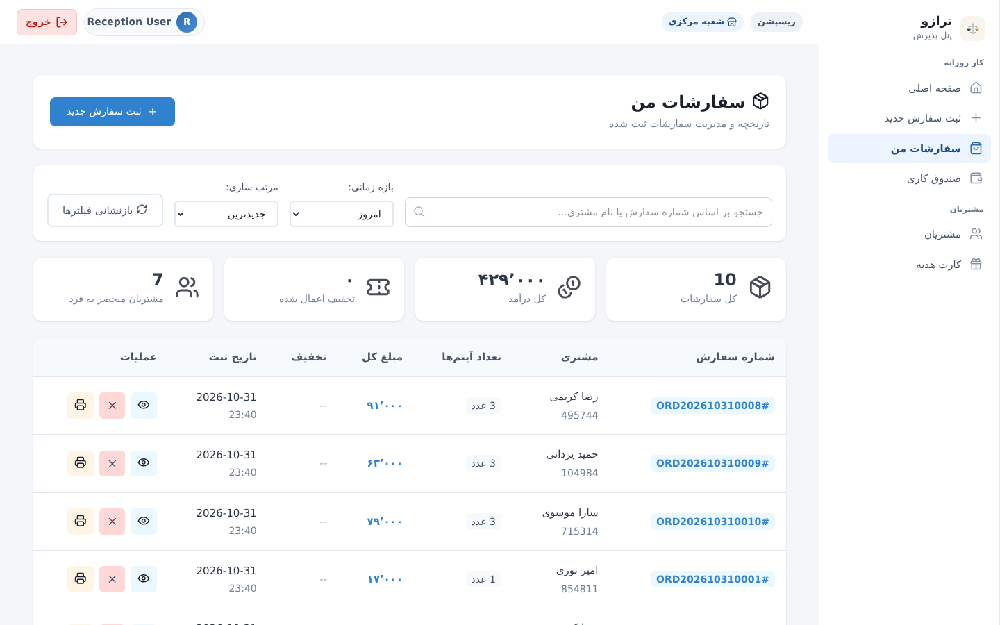
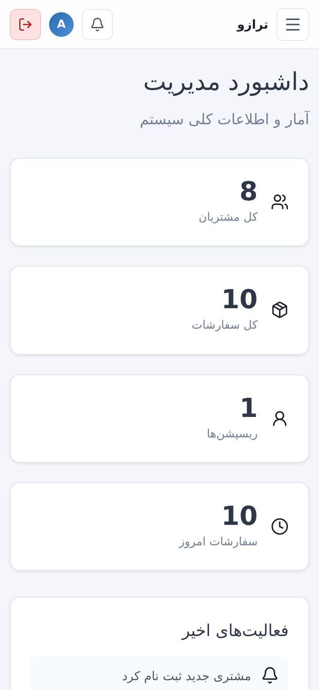
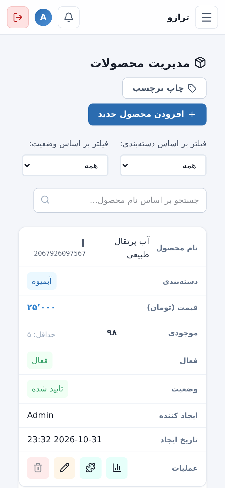
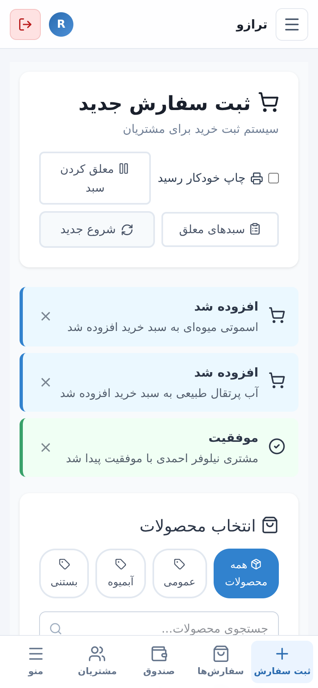
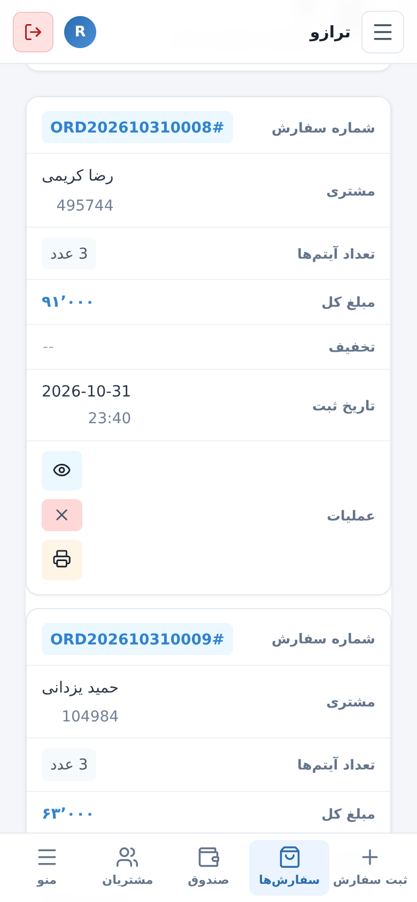

<div align="center">


# Tarazu (ترازو)

A point-of-sale and back-office system for shops, restaurants, cafés, and any business that needs fast order entry, stock control, and clear reporting.

[](https://laravel.com)
[](https://vuejs.org)
[](https://www.php.net)

[فارسی](README.md) · [Known issues](KNOWN_ISSUES.md) · [Quick start](#quick-start)

</div>

---

## Screenshots

> Screenshots use sample data.

### Desktop

<table>
<tr>
<td width="50%"><br><sub>Admin dashboard: sales, customers, and recent activity</sub></td>
<td width="50%"><br><sub>Product management: filters, search, stock, and quick actions</sub></td>
</tr>
<tr>
<td width="50%"><br><sub>New order: customer lookup, product picking, and the cart</sub></td>
<td width="50%"><br><sub>My orders: search, date-range filter, and receipt printing</sub></td>
</tr>
</table>

### Mobile

<table>
<tr>
<td align="center" width="25%"><br><sub>Dashboard</sub></td>
<td align="center" width="25%"><br><sub>Tables become cards</sub></td>
<td align="center" width="25%"><br><sub>New order with bottom tab bar</sub></td>
<td align="center" width="25%"><br><sub>Orders as cards</sub></td>
</tr>
</table>

---

## Features

### Sales and reception (reception role)

- **Order entry** with live stock checks. If any step fails, the whole order is rolled back, so no partial order is saved.
- **Held carts**: park a cart and resume it later. There is a limit on how many can be held, and stock is checked again on resume.
- **Exchanges** with the price difference calculated (positive or negative). If the replacement item is out of stock, the exchange is rolled back.
- **Returns**, full or partial, limited to the quantity still returnable. Stock goes back to the order's branch.
- **Gift cards**: issue, look up, and use them in a sale.
- **Barcodes**: find products by barcode and print barcode labels (EAN-13 layout).
- **Receipt printing** and product photos.
- **Cash shifts**: open and close a shift and record cash movements.
- **Offline mode**: the menu and branch stock are cached. Orders are saved in a local queue with a `client_uuid` and sent when the connection returns. Sending the same order twice does not apply its stock or points again.

### Customers, discounts, and loyalty

- **Customers with a unique 6-digit membership number**, with search, pagination, and purchase history.
- **Discounts**: percentage, fixed amount, and free-product rewards. A discount can apply automatically (by total purchases, monthly purchases, or birthday) or be assigned manually by an admin. Discounts marked *auto-disable after use* are never applied twice.
- **Loyalty points** and manual point adjustments by an admin.

### Products, stock, and branches (admin role)

- Categories, products (with images and variants), stock adjustments, and a **stock history** for each product.
- **Purchase orders** from suppliers: create, receive (into a chosen branch), and cancel.
- **Branches**: a main branch (cannot be deactivated) and separate stock for each branch. A product's total stock is the sum across branches.
- **Stock transfers between branches**: create (deducted from the source and marked *in transit*), receive at the destination, and cancel with stock returned to the source.

### Reports and data

- Sales, orders, customers, and discount reports with period-over-period change, daily and hourly breakdowns, and reception performance. Reports can be filtered by branch.
- **CSV export** (UTF-8 with BOM, safe from formula injection in Excel).
- **Value-added tax (VAT)**: calculated on VAT-inclusive prices, with the rate stored on each order.
- **Admin reports**: dashboard, category sales, and monthly and daily sales reports.
- **Audit log** with a history of changes.
- **Backup and restore** from the admin panel. Restoring does not clear the audit log.
- **SMS campaigns** with a recipient preview and cancellation.

### Notifications and SMS

- **Live notifications** with Laravel Reverb: admins receive new-order, new-customer, and birthday events; reception receives discount-applied events.
- **Stored notifications**: a bell in the navbar shows the unread count and lists only the user's own notifications.
- **Birthday SMS**: `php artisan check:birthdays` runs daily at 08:00. It sends a congratulation SMS to customers whose birthday is today and applies their birthday discount.
- **SMS**: one `SmsService` handles all messages. The default driver only writes to the log. The `kavenegar` driver sends real SMS once an API key is set. SMS failures are logged and never block an order or a customer save.

---

## Quick start

### Requirements

- PHP 8.2+ with the `intl`, `pdo_sqlite` or `pdo_mysql`, `mbstring`, and `openssl` extensions
- Composer 2
- Node.js 20+ and npm
- A database: SQLite (default in `.env.example`) or MySQL/PostgreSQL

### Install

```bash
git clone <repo-url> business-management-system
cd business-management-system

# installs PHP and JS dependencies, creates .env, generates APP_KEY, runs migrations, builds the frontend
composer run setup
```

`composer run setup` runs the migrations but does not create any user accounts. Create the first admin and reception accounts with:

```bash
php artisan db:seed --class=CategorySeeder    # default product categories (optional)
php artisan db:seed --class=AdminUserSeeder   # creates admin@example.com and reception@example.com
```

> ⚠️ The default password for these accounts is `password`. **Change it right after the first login**, or delete the accounts in production. `AdminUserSeeder` is idempotent (`firstOrCreate`), so it is safe to run again.

### Local development

```bash
composer run dev
```

This starts five processes at once:

| Process | Purpose |
| --- | --- |
| `php artisan serve` | HTTP server (default http://127.0.0.1:8000) |
| `php artisan queue:listen` | Queue worker (needed for queued listeners and broadcasts) |
| `php artisan reverb:start` | WebSocket server for live notifications |
| `php artisan pail` | Log tail |
| `npm run dev` | Vite dev server for the frontend |

In production, run the queue worker and Reverb under a process manager such as Supervisor or systemd, and build the frontend with `npm run build`:

```bash
php artisan queue:work --tries=3
php artisan reverb:start --host=0.0.0.0 --port=8080
```

---

## Environment variables

Copy `.env.example` to `.env` (`composer run setup` does this for you). The keys that matter:

| Key | Notes |
| --- | --- |
| `APP_NAME` | Application name; defaults to "ترازو". |
| `APP_DEBUG` | `false` in `.env.example`. Set `true` only on a development machine: it exposes stack traces. |
| `APP_URL`, `APP_TIMEZONE` | `APP_TIMEZONE` defaults to `Asia/Tehran`; daily and monthly reports use it. |
| `DB_CONNECTION`, `DB_*` | SQLite by default. |
| `QUEUE_CONNECTION=database` | Queued listeners (welcome, birthday, and thank-you SMS) and broadcasts need a running `queue:work` or `queue:listen`. Run the migrations first so the `jobs` table exists. |
| `VAT_RATE` | VAT percentage, for example `9`. Default `0` (off). Prices are treated as VAT-inclusive: the tax is `amount × rate ÷ (100 + rate)` and the customer still pays the same total. Each order stores the rate used when it was placed, so changing this later does not change past orders. Only `0`–`100` is accepted. |
| `SANCTUM_TOKEN_EXPIRATION` | Minutes before an API token expires. Default `720` (12 hours). |
| `SMS_DRIVER` | `log` (default: messages are only written to the log) or `kavenegar`. |
| `SMS_KAVENEGAR_API_KEY`, `SMS_SENDER` | Required when `SMS_DRIVER=kavenegar`. Without a key the driver logs a warning and sends nothing. |
| `SMS_ORDER_THANK_YOU` | `false` by default. Set `true` to send a thank-you SMS after each order (this costs money per message). |
| `BROADCAST_CONNECTION=reverb` | Use `log` only if you do not need live notifications. With `log`, the broadcast auth endpoint accepts every channel, so do not use it in production. |
| `REVERB_APP_ID`, `REVERB_APP_KEY`, `REVERB_APP_SECRET` | Change `REVERB_APP_SECRET` in production. |
| `REVERB_HOST`, `REVERB_PORT`, `REVERB_SCHEME` | Where the WebSocket server is reachable from the server side. |
| `VITE_REVERB_APP_KEY`, `VITE_REVERB_HOST`, `VITE_REVERB_PORT`, `VITE_REVERB_SCHEME` | Values the browser uses to connect. They are compiled into the frontend, so run `npm run build` again after changing them. |

Private-channel authorization runs at `POST /api/broadcasting/auth` and requires a Sanctum bearer token. Channels are defined in `routes/channels.php`.

Set `SMS_DRIVER` in production and keep `APP_DEBUG=false`. Run `php artisan schedule:work` in development, or the cron entry `* * * * * php /path/to/artisan schedule:run` in production, so the daily birthday check runs.

---

## Roles and pages

| Role | Frontend routes | API prefix |
| --- | --- | --- |
| admin | dashboard, customers, categories, products, discounts, cash shifts, SMS campaigns, reports, users, purchase orders, branches, stock transfers, gift cards, barcode labels, audit logs, backups | `/api/admin/*` |
| reception | dashboard, new order, my orders, cash shift, customers, gift cards | `/api/reception/*` |

Roles are enforced on the server by the `admin` and `reception` middleware. Frontend route guards only improve the user experience. Admins cannot deactivate, demote, or delete their own account (the API returns 422).

## Authentication

- `POST /api/login` returns a Sanctum token. The SPA stores it and sends it as `Authorization: Bearer <token>`.
- Tokens expire after 12 hours (`SANCTUM_TOKEN_EXPIRATION`). Any API call that returns 401 clears the session and sends the user to the login page with an "expired" notice.
- Brute-force protection on login:
  - 5 failed attempts for the same email and IP lock that pair for 60 seconds; the next attempt returns `429` with a `Retry-After` header. A correct password does not bypass the lock.
  - The whole `/api/login` route is also limited to 30 requests per minute per IP.
- `GET /api/user` returns the current user and is used to restore the session on page load.
- `POST /api/logout` revokes the current token.
- The token is kept in `localStorage`. Moving it to an HttpOnly cookie is a larger change (it needs cookie-based auth and CSRF handling) and is not done yet.

## Useful commands

```bash
php artisan migrate                   # apply migrations
php artisan migrate:fresh --seed      # reset the database (destroys data)
npm run build                         # production frontend build
php artisan route:list --path=api     # list API routes
php artisan optimize                  # cache config, routes, and views for production
php artisan check:birthdays --notify  # run the birthday check now (also runs daily at 08:00)
npm run lint                          # ESLint for the Vue/JS frontend
```

## Testing

The PHPUnit tests live in `tests/Feature` and cover login lockout, discount validation, the product-delete guard, order-number retry, SMS drivers, notifications, VAT, held carts, and exchanges.

PHPUnit is listed in `composer.json`, but `composer.lock` was not regenerated with it. Run this once to refresh the lock file (it also drops the unused `laravel/breeze` package):

```bash
composer require --dev phpunit/phpunit:^11.5.3
php artisan test
```

Frontend and build checks:

```bash
npm run lint
npm run build
```

## Known gaps

- **SMS is not live until configured.** The default `log` driver sends nothing to customers. Set `SMS_DRIVER=kavenegar` and the API key to send real messages. The Kavenegar driver follows the provider's documented `sms/send.json` endpoint but has not been tested against a live account.
- **Birthday email is not implemented.** Customers have no email field.
- **Tokens are in `localStorage`** (see *Authentication*). HttpOnly cookies are deferred.
- See [KNOWN_ISSUES.md](KNOWN_ISSUES.md) for the full list with status and file references.

## Project layout

```
app/
  Events/            broadcast events (NewOrderCreated, NewCustomerRegistered, DiscountApplied, ...)
  Http/Controllers/  Admin/ and Reception/ controllers
  Http/Middleware/   AdminMiddleware, ReceptionMiddleware
  Listeners/         customer, order, and birthday listeners (SMS listeners are queued)
  Models/            Order, Customer, Product, Discount, Branch, User, Notification, ...
  Services/          DiscountService, SmsService, LoyaltyService, StockService, BackupService, ...
database/
  migrations/        schema
  seeders/           CategorySeeder, AdminUserSeeder, DemoProductSeeder (optional), ...
docs/screenshots/    README screenshots
resources/js/
  views/Admin/       admin pages
  views/Reception/   reception pages (new order, returns, exchanges, held carts, offline mode)
  components/Layout/ navbar (with the notification bell) and role layouts
  utils/             number formatting, receipts, EAN-13 barcodes, offline queue
  realtime.js        Echo subscriptions per role
routes/
  api.php            API routes
  channels.php       broadcast channel authorization
  console.php        scheduled commands (daily birthday check)
tests/
  Feature/           PHPUnit feature tests
  Concerns/          shared test data helpers
```
