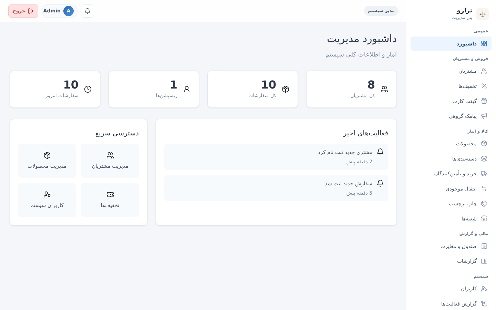
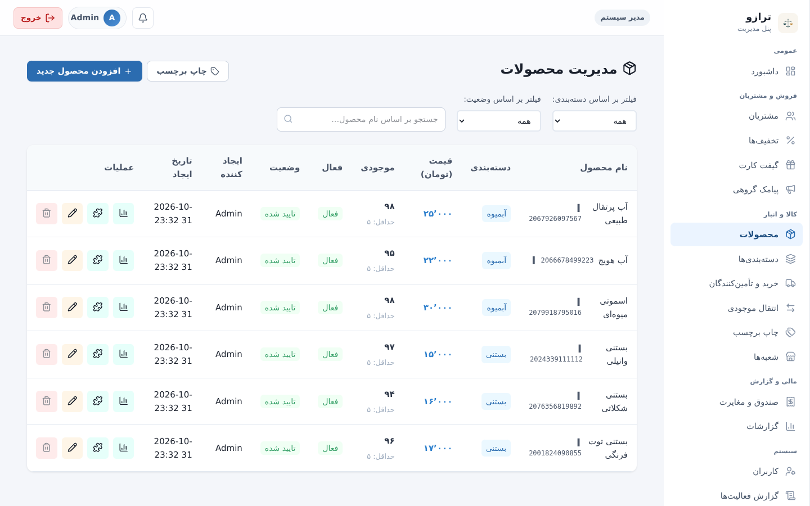
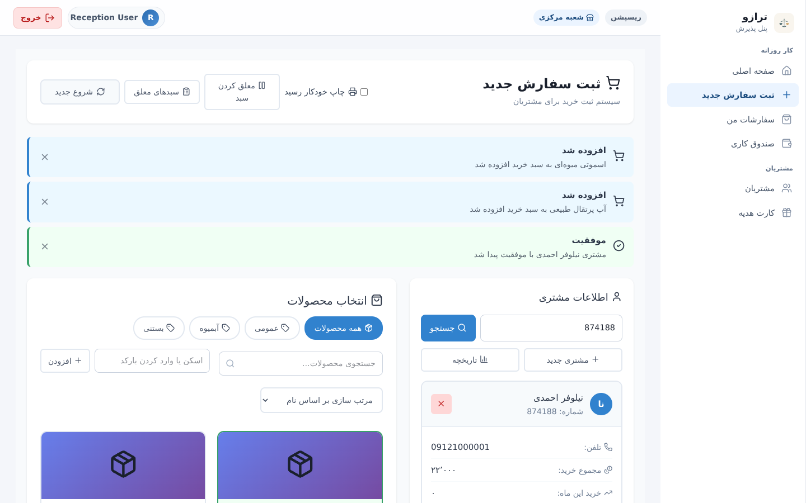
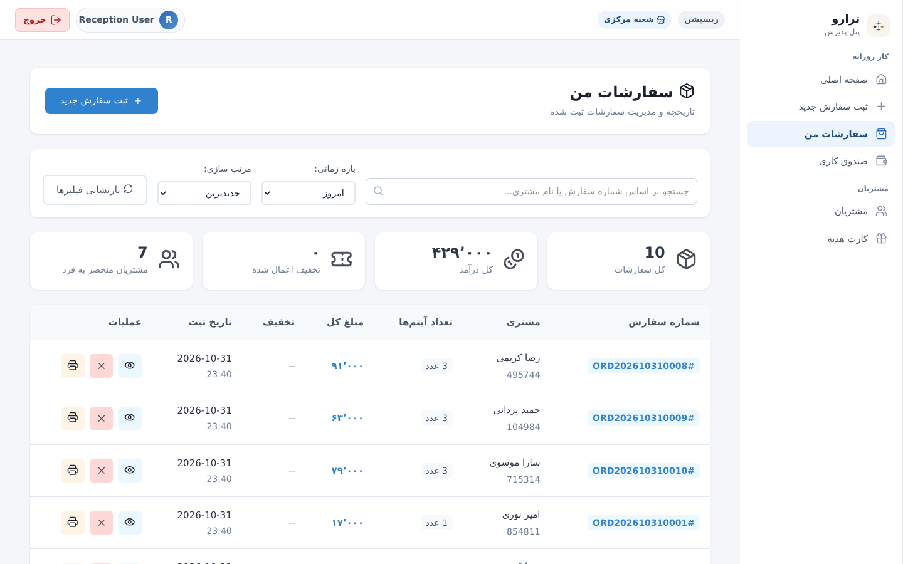
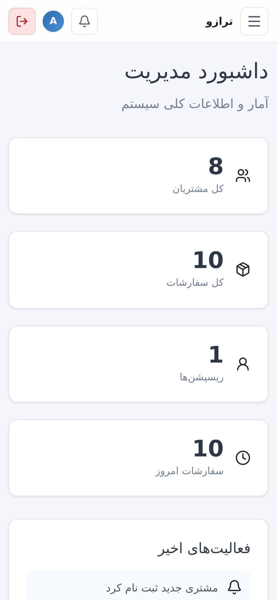
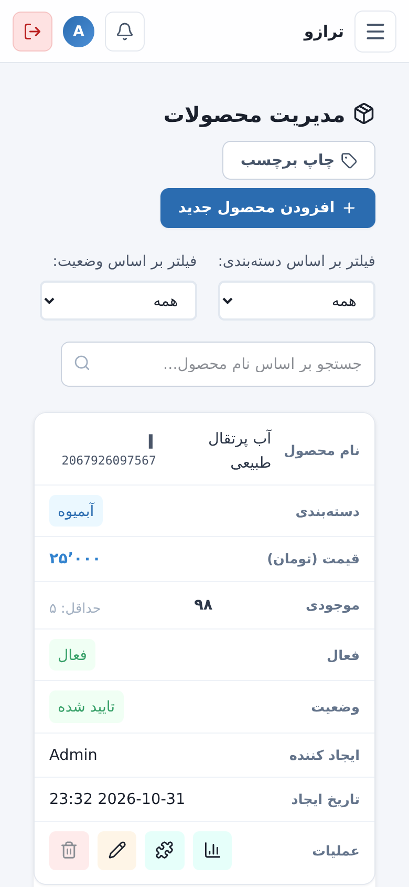
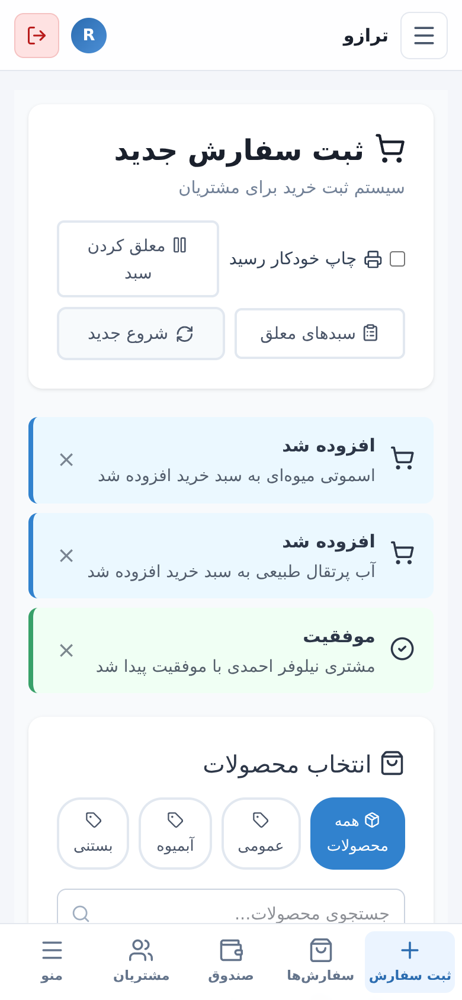
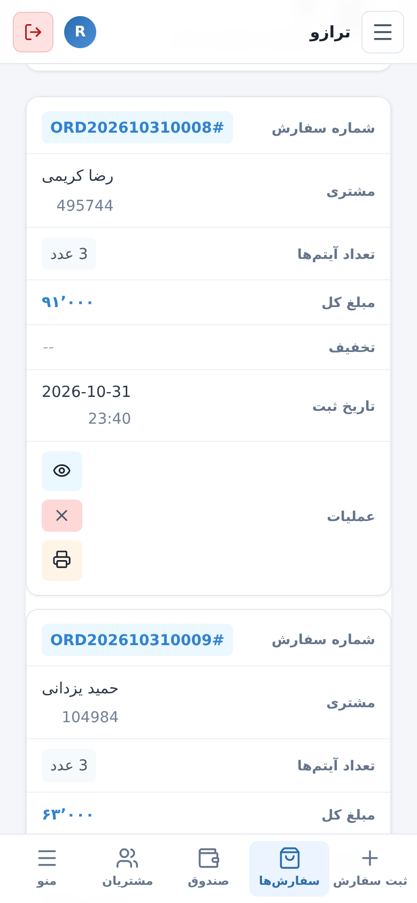

<div align="center">


# ترازو (Tarazu)

سامانه‌ی فروش و مدیریت پشت‌صحنه برای فروشگاه، رستوران، کافه و هر کسب‌وکاری که به پذیرش سریع، کنترل موجودی و گزارش دقیق نیاز دارد.

[](https://laravel.com)
[](https://vuejs.org)
[](https://www.php.net)

[English](README.en.md) · [مشکلات شناخته‌شده](KNOWN_ISSUES.md) · [شروع سریع](#شروع-سریع)

</div>

---

## تصاویر

> تصاویر با داده‌ی نمونه گرفته شده‌اند.

### دسکتاپ

<table>
<tr>
<td width="50%"><br><sub>داشبورد مدیریت: آمار فروش، مشتریان و فعالیت‌های اخیر</sub></td>
<td width="50%"><br><sub>مدیریت محصولات: فیلتر، جست‌وجو، موجودی و عملیات سریع</sub></td>
</tr>
<tr>
<td width="50%"><br><sub>ثبت سفارش: اطلاعات مشتری، انتخاب محصول و سبد خرید</sub></td>
<td width="50%"><br><sub>سفارش‌های من: جست‌وجو، فیلتر بازه‌ی زمانی و چاپ رسید</sub></td>
</tr>
</table>

### موبایل

<table>
<tr>
<td align="center" width="25%"><br><sub>داشبورد</sub></td>
<td align="center" width="25%"><br><sub>جدول‌ها به صورت کارت</sub></td>
<td align="center" width="25%"><br><sub>ثبت سفارش و نوار پایین</sub></td>
<td align="center" width="25%"><br><sub>سفارش‌ها به صورت کارت</sub></td>
</tr>
</table>

---

## امکانات

### فروش و پذیرش (نقش پذیرش)

- **ثبت سفارش** با بررسی موجودی لحظه‌ای. اگر هر مرحله‌ای خطا بدهد، کل سفارش برگشت داده می‌شود و سفارش ناقص ثبت نمی‌شود.
- **سبد معلق**: ذخیره‌ی موقت یک سبد و ادامه‌ی آن بعداً. سقف تعداد سبدهای معلق دارد و هنگام ادامه، موجودی دوباره بررسی می‌شود.
- **تعویض کالا** با محاسبه‌ی اختلاف قیمت (مثبت یا منفی) و برگشت خودکار در صورت کمبود موجودی کالای جایگزین.
- **مرجوعی کالا** کامل یا جزئی، با محدودیت تعداد قابل برگشت. موجودی به شعبه‌ی همان سفارش برمی‌گردد.
- **کارت هدیه**: صدور، مشاهده و استفاده در فروش.
- **بارکد**: جست‌وجوی محصول با بارکد و چاپ برچسب بارکد (قالب EAN-13).
- **چاپ رسید** و نمایش عکس محصول.
- **صندوق کاری (شیفت صندوق)**: باز و بسته کردن شیفت و ثبت گردش صندوق.
- **حالت آفلاین**: منوی کش‌شده و موجودی کش‌شده‌ی شعبه. سفارش‌ها با `client_uuid` در صف محلی ذخیره و هنگام اتصال مجدد ارسال می‌شوند. ارسال تکراری یک سفارش، موجودی یا امتیاز را دوباره اعمال نمی‌کند.

### مشتریان، تخفیف و وفاداری

- **مشتری با شماره‌ی عضویت یکتای ۶ رقمی**، جست‌وجو، صفحه‌بندی و تاریخچه‌ی خرید.
- **تخفیف**: درصدی، مبلغ ثابت و جایزه‌ی کالای رایگان. تخفیف می‌تواند خودکار (بر اساس مجموع خرید، خرید ماهانه یا تولد) یا دستی توسط ادمین اعمال شود. تخفیف‌هایی که «پس از یک بار استفاده غیرفعال شوند» دوبار اعمال نمی‌شوند.
- **امتیاز وفاداری** و تعدیل دستی امتیاز توسط ادمین.

### مدیریت کالا و موجودی (نقش ادمین)

- دسته‌بندی، محصولات (با تصویر و واریانت)، تعدیل موجودی و **تاریخچه‌ی موجودی** هر محصول.
- **سفارش خرید** از تأمین‌کننده: ثبت، دریافت (به شعبه‌ی انتخابی) و لغو.
- **شعبه‌ها**: شعبه‌ی مرکزی (غیرقابل غیرفعال‌سازی) و موجودی جدا برای هر شعبه. موجودی کل محصول مجموع موجودی شعبه‌هاست.
- **انتقال موجودی بین شعبه‌ها**: ایجاد (کسر از مبدأ و قرار گرفتن در «در راه»)، دریافت در مقصد، و لغو با بازگشت موجودی به مبدأ.

### گزارش‌ها و پشتیبانی داده

- گزارش فروش، سفارش‌ها، مشتریان و تخفیف‌ها با مقایسه‌ی دوره‌ی قبل، نمودارهای روزانه و ساعتی، و عملکرد پذیرش. گزارش‌ها بر اساس شعبه قابل فیلترند.
- **خروجی CSV** (UTF-8 با BOM و مقاوم در برابر تزریق فرمول در اکسل).
- **مالیات بر ارزش افزوده (VAT)**: محاسبه روی قیمت‌های شامل مالیات و ذخیره‌ی نرخ در هر سفارش.
- **گزارش‌های ادمین**: داشبورد، گزارش فروش دسته‌بندی‌شده، و گزارش‌های فروش ماهانه و روزانه.
- **لاگ فعالیت (Audit log)** با تاریخچه‌ی تغییرات.
- **بکاپ و بازیابی** از پنل ادمین. بازیابی جدول لاگ فعالیت را پاک نمی‌کند.
- **کمپین پیامکی** با پیش‌نمایش گیرندگان و لغو کمپین.

### اعلان و پیامک

- **اعلان‌های لحظه‌ای** با Laravel Reverb: ادمین‌ها رویدادهای سفارش جدید، مشتری جدید و تولد را دریافت می‌کنند؛ پذیرش رویدادهای اعمال تخفیف را دریافت می‌کند.
- **اعلان‌های ذخیره‌شده**: زنگوله‌ی اعلان در نوار بالا با تعداد خوانده‌نشده، و فقط اعلان‌های خود کاربر.
- **پیامک تولد**: دستور `php artisan check:birthdays` هر روز ساعت ۸ صبح اجرا می‌شود و برای مشتریان متولد امروز پیامک تبریک می‌فرستد و تخفیف تولد را اعمال می‌کند.
- **پیامک**: یک سرویس واحد (`SmsService`). درایور پیش‌فرض فقط در لاگ می‌نویسد و با `kavenegar` پیامک واقعی ارسال می‌شود. خطای پیامک هرگز سفارش یا ثبت مشتری را متوقف نمی‌کند.

---

## شروع سریع

### نیازمندی‌ها

- PHP ۸.۲ یا بالاتر با افزونه‌های `intl`، `pdo_sqlite` یا `pdo_mysql`، `mbstring` و `openssl`
- Composer 2
- Node.js ۲۰ یا بالاتر و npm
- پایگاه داده: SQLite (پیش‌فرض در `.env.example`) یا MySQL/PostgreSQL

### نصب

```bash
git clone <repo-url> business-management-system
cd business-management-system

# نصب وابستگی‌های PHP و JS، ساخت .env، تولید APP_KEY، اجرای migrate و ساخت فرانت‌اند
composer run setup
```

`composer run setup` فقط جدول‌ها را می‌سازد و هیچ کاربری ایجاد نمی‌کند. برای ساخت حساب ادمین و پذیرش:

```bash
php artisan db:seed --class=CategorySeeder    # دسته‌بندی‌های پیش‌فرض (اختیاری)
php artisan db:seed --class=AdminUserSeeder   # admin@example.com و reception@example.com
```

> ⚠️ رمز عبور پیش‌فرض این حساب‌ها `password` است. **بلافاصله بعد از اولین ورود آن را تغییر دهید** یا در محیط واقعی این حساب‌ها را حذف کنید. `AdminUserSeeder` امن برای اجرای دوباره است (`firstOrCreate`).

### اجرا در محیط توسعه

```bash
composer run dev
```

این دستور پنج فرآیند را هم‌زمان اجرا می‌کند:

| فرآیند | کاربرد |
| --- | --- |
| `php artisan serve` | سرور HTTP (پیش‌فرض http://127.0.0.1:8000) |
| `php artisan queue:listen` | کارگر صف (برای listenerها و broadcastها لازم است) |
| `php artisan reverb:start` | سرور WebSocket برای اعلان‌های لحظه‌ای |
| `php artisan pail` | نمایش لاگ‌ها |
| `npm run dev` | سرور Vite برای فرانت‌اند |

در محیط واقعی، کارگر صف و Reverb را با یک مدیر فرآیند مثل Supervisor یا systemd اجرا کنید و فرانت‌اند را با `npm run build` بسازید:

```bash
php artisan queue:work --tries=3
php artisan reverb:start --host=0.0.0.0 --port=8080
```

---

## متغیرهای محیطی

`.env.example` را به `.env` کپی کنید (این کار با `composer run setup` خودکار انجام می‌شود). کلیدهای مهم:

| کلید | توضیح |
| --- | --- |
| `APP_NAME` | نام برنامه؛ پیش‌فرض «ترازو». |
| `APP_DEBUG` | در `.env.example` برابر `false` است. فقط روی ماشین توسعه `true` بگذارید، چون خطاها و مسیرها را نشان می‌دهد. |
| `APP_URL`، `APP_TIMEZONE` | `APP_TIMEZONE` پیش‌فرض `Asia/Tehran` است و گزارش‌های روزانه و ماهانه از آن استفاده می‌کنند. |
| `DB_CONNECTION` و `DB_*` | پیش‌فرض SQLite. |
| `QUEUE_CONNECTION=database` | پیامک‌های خوش‌آمد، تولد و تشکر و همچنین broadcastها به کارگر صف نیاز دارند. ابتدا migrate را اجرا کنید تا جدول `jobs` ساخته شود. |
| `VAT_RATE` | درصد مالیات، مثلاً `9`. پیش‌فرض `0` (خاموش) است. قیمت‌ها شامل مالیات فرض می‌شوند: مالیات = `مبلغ × نرخ ÷ (۱۰۰ + نرخ)` و مشتری همان مبلغ کل را می‌پردازد. نرخ هر سفارش در زمان ثبت ذخیره می‌شود، پس تغییر بعدی آن سفارش‌های قبلی را تغییر نمی‌دهد. فقط مقدار `۰` تا `۱۰۰` پذیرفته می‌شود. |
| `SANCTUM_TOKEN_EXPIRATION` | مدت اعتبار توکن بر حسب دقیقه. پیش‌فرض `720` (۱۲ ساعت). |
| `SMS_DRIVER` | `log` (پیش‌فرض، فقط در لاگ ثبت می‌شود) یا `kavenegar`. |
| `SMS_KAVENEGAR_API_KEY`، `SMS_SENDER` | برای `kavenegar` لازم‌اند. بدون کلید، درایور هشدار می‌دهد و چیزی ارسال نمی‌کند. |
| `SMS_ORDER_THANK_YOU` | پیش‌فرض `false`. با `true` بعد از هر سفارش پیامک تشکر ارسال می‌شود (هزینه‌بر است). |
| `BROADCAST_CONNECTION=reverb` | `log` را فقط وقتی استفاده کنید که اعلان لحظه‌ای نمی‌خواهید. در این حالت احراز کانال برای همه باز است، پس در محیط واقعی از آن استفاده نکنید. |
| `REVERB_APP_ID`، `REVERB_APP_KEY`، `REVERB_APP_SECRET` | در محیط واقعی `REVERB_APP_SECRET` را حتماً تغییر دهید. |
| `REVERB_HOST`، `REVERB_PORT`، `REVERB_SCHEME` | آدرس سرور WebSocket از دید سرور. |
| `VITE_REVERB_APP_KEY`، `VITE_REVERB_HOST`، `VITE_REVERB_PORT`، `VITE_REVERB_SCHEME` | مقادیری که مرورگر برای اتصال استفاده می‌کند. در زمان build داخل فرانت‌اند قرار می‌گیرند، پس بعد از تغییر دوباره `npm run build` بزنید. |

احراز هویت کانال‌های خصوصی در `POST /api/broadcasting/auth` و با توکن Sanctum انجام می‌شود. کانال‌ها در `routes/channels.php` تعریف شده‌اند.

در محیط واقعی حتماً `SMS_DRIVER` را تنظیم کنید و `APP_DEBUG=false` بماند. برای اجرای بررسی روزانه‌ی تولد، در توسعه `php artisan schedule:work` و در سرور این خط cron را اضافه کنید:

```bash
* * * * * php /path/to/artisan schedule:run
```

---

## نقش‌ها و صفحات

| نقش | مسیرهای فرانت‌اند | پیشوند API |
| --- | --- | --- |
| ادمین (`admin`) | داشبورد، مشتریان، تخفیف‌ها، صندوق‌ها، پیامک، گزارش‌ها، کاربران، سفارش خرید، شعبه‌ها، انتقال موجودی، کارت هدیه، برچسب بارکد، لاگ فعالیت، بکاپ، دسته‌بندی‌ها و محصولات | `/api/admin/*` |
| پذیرش (`reception`) | داشبورد، ثبت سفارش، سفارش‌های من، صندوق کاری، مشتریان، کارت هدیه | `/api/reception/*` |

نقش‌ها در سمت سرور با میان‌افزارهای `admin` و `reception` کنترل می‌شوند و محدودیت‌های فرانت‌اند فقط برای تجربه‌ی کاربری است. ادمین نمی‌تواند حساب خودش را غیرفعال، تنزل سطح یا حذف کند (پاسخ API کد ۴۲۲ است).

---

## احراز هویت

- `POST /api/login` یک توکن Sanctum برمی‌گرداند. فرانت‌اند آن را در `localStorage` نگه می‌دارد و با هدر `Authorization: Bearer <token>` ارسال می‌کند.
- توکن بعد از ۱۲ ساعت منقضی می‌شود. هر پاسخ `401` نشست را پاک می‌کند و کاربر را با پیام «منقضی شده» به صفحه‌ی ورود می‌فرستد.
- محدودسازی تلاش ورود:
  - ۵ تلاش ناموفق برای یک ایمیل و IP، آن ترکیب را ۶۰ ثانیه قفل می‌کند و تلاش بعدی `429` با هدر `Retry-After` می‌گیرد. ورود با رمز درست هم قفل را دور نمی‌زند.
  - کل مسیر `/api/login` هم به ۳۰ درخواست در دقیقه برای هر IP محدود است.
- `GET /api/user` کاربر فعلی را برمی‌گرداند و برای بازیابی نشست هنگام باز شدن صفحه استفاده می‌شود.
- `POST /api/logout` توکن فعلی را باطل می‌کند.

---

## دستورهای مفید

```bash
php artisan migrate                       # اجرای migrationها
php artisan migrate:fresh --seed          # بازسازی پایگاه داده (تمام داده‌ها پاک می‌شوند)
npm run build                             # ساخت فرانت‌اند برای محیط واقعی
php artisan route:list --path=api         # فهرست مسیرهای API
php artisan optimize                      # کش کردن تنظیمات، مسیرها و view ها
php artisan check:birthdays --notify      # اجرای دستی بررسی تولد
npm run lint                              # ESLint برای فرانت‌اند
```

---

## آزمون‌ها

تست‌های PHPUnit در `tests/Feature` هستند و قفل ورود، اعتبارسنجی تخفیف، محافظ حذف محصول، شماره‌ی سفارش، درایورهای پیامک، اعلان‌ها، VAT، سبد معلق و تعویض کالا را پوشش می‌دهند.

اگر `composer.lock` شامل PHPUnit نیست، یک بار آن را به‌روز کنید:

```bash
composer require --dev phpunit/phpunit:^11.5.3
php artisan test
```

بررسی‌های فرانت‌اند:

```bash
npm run lint
npm run build
```

---

## مشکلات شناخته‌شده

فهرست کامل، وضعیت هر مورد و مسیر فایل‌های مرتبط در [KNOWN_ISSUES.md](KNOWN_ISSUES.md) آمده است. مهم‌ترین موارد باز:

- **پیامک تا زمانی که پیکربندی نشود ارسال نمی‌شود.** درایور `log` به مشتری چیزی نمی‌فرستد.
- **مشتریان قدیمی رضایت پیامک ندارند.** رضایت فقط برای مشتریانی ثبت می‌شود که از فرم گرفته شده‌اند.
- **پیامک تولد با ایمیل** پیاده‌سازی نشده است، چون مشتریان فیلد ایمیل ندارند.
- **توکن‌ها در `localStorage` هستند.** انتقال به کوکی HttpOnly کار بزرگ‌تری است و هنوز انجام نشده است.
- **تخفیف و امتیاز در حالت آفلاین** صفر محاسبه می‌شوند و سرور هنگام همگام‌سازی مبلغ نهایی را تعیین می‌کند.

---

## ساختار پروژه

```
app/
  Events/            رویدادهای broadcast (سفارش جدید، مشتری جدید، اعمال تخفیف و …)
  Http/Controllers/  کنترلرهای Admin و Reception
  Http/Middleware/   AdminMiddleware و ReceptionMiddleware
  Listeners/         listenerهای مشتری، سفارش و تولد (پیامک‌ها در صف هستند)
  Models/            Order، Customer، Product، Discount، Branch، User، Notification و …
  Services/          DiscountService، SmsService، LoyaltyService، StockService، BackupService و …
database/
  migrations/        ساختار جدول‌ها
  seeders/           CategorySeeder، AdminUserSeeder، DemoProductSeeder (اختیاری) و …
docs/screenshots/    تصاویر README
resources/js/
  views/Admin/       صفحات ادمین
  views/Reception/   صفحات پذیرش (ثبت سفارش، مرجوعی، تعویض کالا، سبد معلق، حالت آفلاین)
  components/Layout/ نوار بالا (با زنگوله‌ی اعلان) و قالب هر نقش
  utils/             قالب‌بندی اعداد، رسید، بارکد EAN-13، صف آفلاین
  realtime.js        اشتراک‌های Echo برای هر نقش
routes/
  api.php            مسیرهای API
  channels.php       احراز کانال‌های broadcast
  console.php        دستورهای زمان‌بندی‌شده (بررسی تولد)
tests/
  Feature/           تست‌های PHPUnit
  Concerns/          کمک‌کننده‌های داده‌ی تست
```
